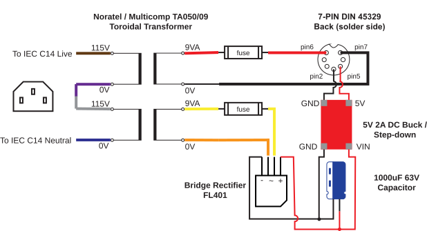
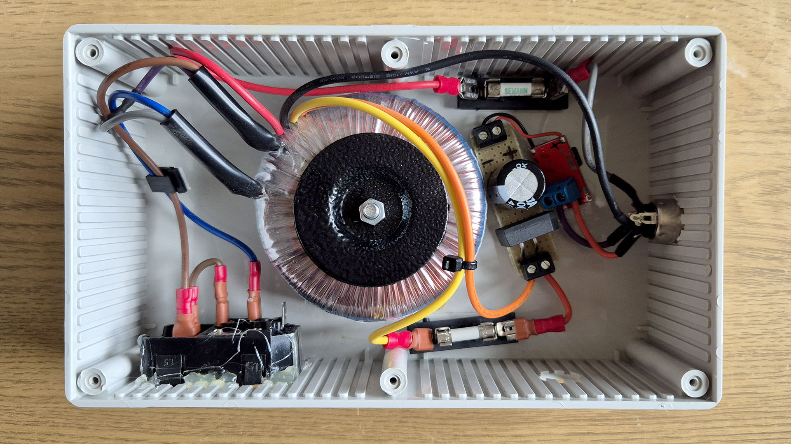
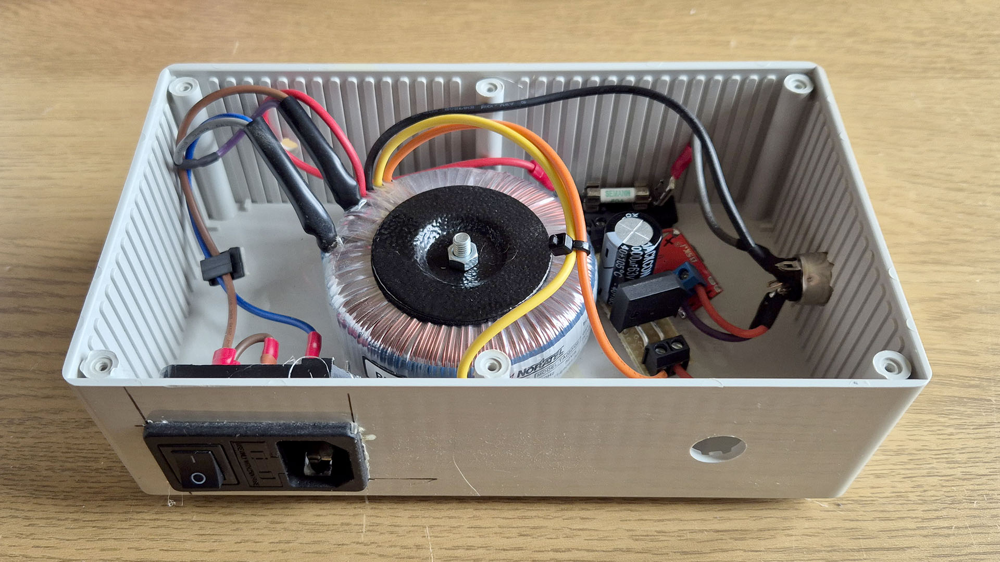
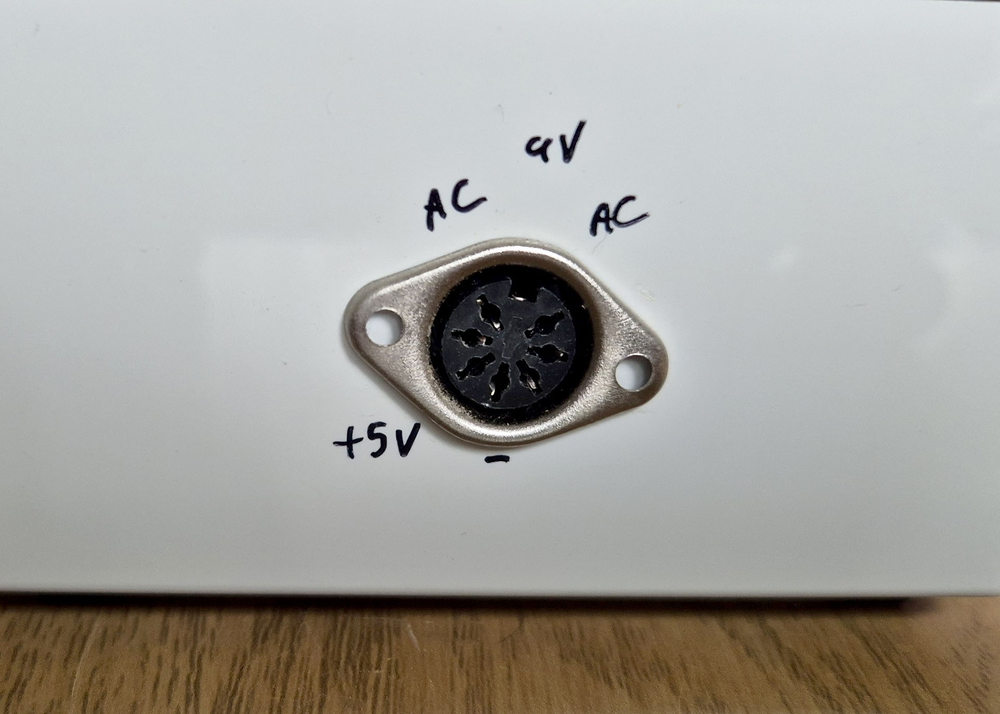
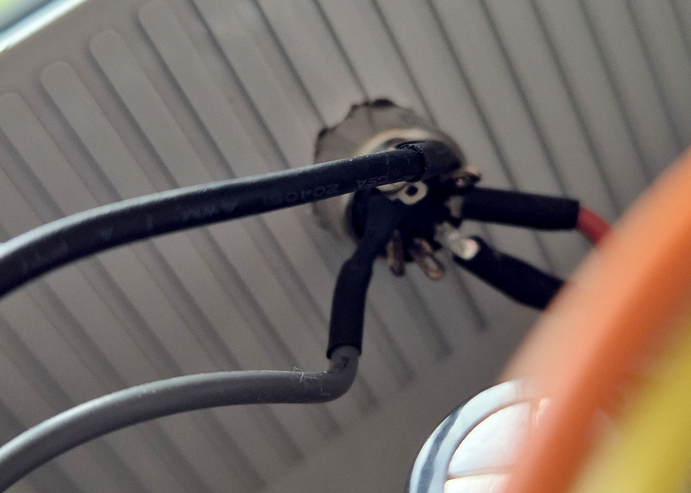

# DIY Commodore 64 PSU

A simple to build DIY PSU for a C64. There is an assumption you have an understanding of how transformers are wired etc.

## Disclaimer

This project is provided *as-is* and is not maintained. The schematics in this repository are for educational and experimental purposes only. Working with electricity, mains voltage, and high-power circuits is dangerous and can result in severe injury, electrocution, or fire. The author(s) assume no responsibility or liability for any errors, damage, or injury caused by the construction, modification, or use of this design. Build and use at your own risk.

## Block diagram

## Bill of materials

| qty | description | part number |
|-----|-------------|-------------|
| 1   | Multicomp Toroidal Transformer | TA050/09 |
| 1   | Multicomp Single Phase Bridge Rectifier | FL401 |
| 1   | QSKJ DC-DC Step-down Buck Converter 2A - 5V (any 5V/2A buck/step down will do) | n/a |
| 1   | 7-pin DIN 45329 male plug | n/a |
| 1   | Enclosure of choice | n/a |

## Build images

|  |  |